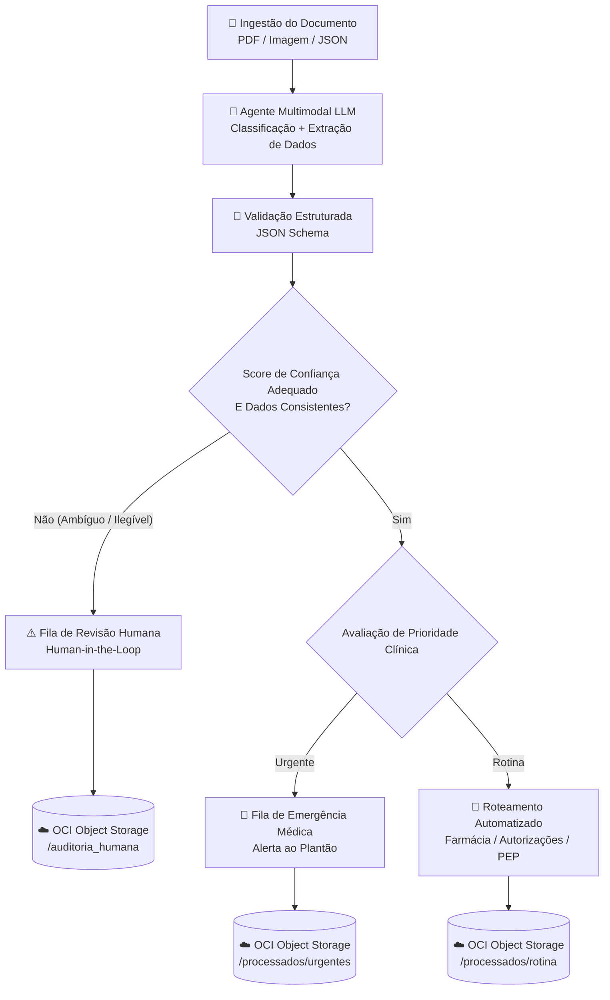

# 🏥 MediFlow – Agente Autônomo para Triagem, Extração e Roteamento de Documentos Clínicos

> **Hackathon ONE (Grupo 10) – Oracle Next Education & Alura**  
> **Equipe:** `g10-Brasil27`

---

## 📌 Sobre o Projeto

O **MediFlow** é um agente autônomo desenvolvido para receber documentos clínicos e administrativos em múltiplos formatos (PDF, Imagem ou JSON), classificá-los automaticamente, extrair entidades clínicas essenciais com alta precisão e roteá-los para o setor hospitalar adequado.

O sistema conta com validação condicional e fluxo **Human-in-the-Loop (HITL)** para reter casos ambíguos ou ilegíveis para revisão humana, priorizar alertas de urgência médica e armazenar os documentos de forma segregada no **Oracle Cloud Infrastructure (OCI) Object Storage (Camada Always Free)**.

---

## 🧠 Fluxo de Decisão do Agente



---

## 📂 Estrutura do Repositório

```text
g10-Brasil27/
├── src/
│   ├── ingestion/      # Recepção e leitura de documentos (PDF / Imagem / JSON)
│   ├── agent/          # Integração com LLM multimodal e extração de dados clínicos
│   ├── routing/        # Lógica de decisão condicional, score de confiança e roteamento
│   ├── storage_oci/    # Persistência no OCI Object Storage (Always Free)
│   ├── schemas/        # Contratos e validação de entrada/saída JSON
│   └── api/            # Interface e endpoints da aplicação
├── samples/            # Casos de teste obrigatórios para demonstração
│   ├── 1_rotina/
│   ├── 2_urgencia/
│   └── 3_auditoria_humana/
├── docs/               # Documentação complementar
└── tests/              # Testes automatizados
```

---

## 🧪 Casos de Teste (MVP)

1. **Cenário 1 – Rotina (`samples/1_rotina`):** Fluxo padrão aprovado e encaminhado automaticamente.
2. **Cenário 2 – Urgência Médica (`samples/2_urgencia`):** Identificação de achado crítico com disparo de alerta de emergência.
3. **Cenário 3 – Auditoria Humana (`samples/3_auditoria_humana`):** Caso ambíguo ou com baixa confiabilidade direcionado para revisão humana.
