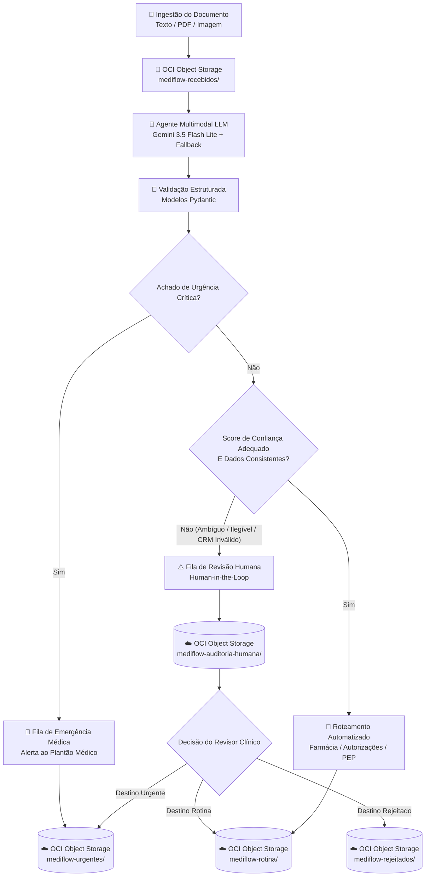

# 🏥 MediFlow – Agente Autônomo para Triagem, Extração e Roteamento de Documentos Clínicos

> **Hackathon ONE (Grupo 10) – Oracle Next Education & Alura**  
> **Equipe:** `g10-Brasil27`  
> **Ambiente no Ar (Deploy OCI Always Free):** `http://137.131.182.189/`

---

## 📌 Sobre o Projeto

O **MediFlow** é um agente autônomo desenvolvido para receber documentos clínicos e administrativos em texto, PDF ou imagem, classificá-los automaticamente, extrair entidades clínicas essenciais e roteá-los para o setor hospitalar adequado.

O sistema conta com validação condicional e fluxo **Human-in-the-Loop (HITL)** para reter casos ambíguos ou ilegíveis para revisão humana, priorizar alertas de urgência médica e armazenar os documentos de forma segregada no **Oracle Cloud Infrastructure (OCI) Object Storage (Camada Always Free)**.

---

## 🧠 Fluxo de Decisão do Agente



---

## 📂 Estrutura do Repositório

```text
g10-Brasil27/
├── contratos/       # Modelos Pydantic de entrada e saída (contrato de dados)
├── regras/          # Regras de consistência, score de confiança e critérios de urgência
├── agente/          # Grafo de decisão e leitura de documentos (texto / PDF / imagem)
├── prompts/         # Prompts de classificação e extração
├── api/             # FastAPI: endpoints, execução do roteamento e alertas
├── armazenamento/   # Persistência no OCI Object Storage (Always Free)
├── interface/       # Telas Streamlit de envio e de auditoria
├── dados_teste/     # Cenários obrigatórios da demonstração (somente dados fictícios)
│   ├── 1_rotina/
│   ├── 2_urgencia/
│   └── 3_auditoria_humana/
├── deploy/          # Docker e configuração da VM na OCI
├── docs/            # Documentação complementar
└── tests/           # Testes automatizados
```

As pastas importadas por outras partes (`contratos/`, `regras/`, `agente/`, `prompts/`, `api/` e `armazenamento/`) têm um arquivo `__init__.py`.

---

## ▶️ Como Executar

### Pré-requisitos

- **Python 3.11 a 3.13** (o Docker e o CI usam o 3.13)
- Git

Para conferir a versão do Python:

```bash
python3 --version        # Linux ou macOS
py --version             # Windows
```

### 1. Criar o ambiente virtual e instalar as dependências

Na raiz do repositório (recomendado com Python 3.13).

Linux ou macOS:

```bash
python3.13 -m venv .venv
source .venv/bin/activate
pip install -r requirements.txt
```

Windows (PowerShell):

```powershell
py -3.13 -m venv .venv
.venv\Scripts\Activate.ps1
pip install -r requirements.txt
```

### 2. Configurar as variáveis de ambiente

Copie o `.env.example` para `.env` e preencha os valores somente na sua máquina. O `.env` nunca vai para o Git.

```bash
cp .env.example .env
```

A API **não sobe sem a chave de acesso** (`MEDIFLOW_API_KEY`). Gere uma e coloque no `.env` (a seção 6 explica):

```bash
python -c "import secrets; print(secrets.token_urlsafe(32))"
```

### 3. Executar

Sempre a partir da raiz do repositório, com a `.venv` ativada e usando `python -m`:

```bash
python -m uvicorn api.main:app --reload      # API
python -m streamlit run interface/app.py     # Interface
python -m pytest                             # Testes
```

Executado com `python -m`, o Python inclui a pasta atual no caminho de importação. Assim, imports entre pastas (por exemplo, `from contratos.modelos import ...`) funcionam em qualquer parte do projeto.

### 4. Modos de armazenamento da API

A API grava cada documento recebido e a resposta da triagem. Onde isso é gravado depende da variável `MEDIFLOW_ARMAZENAMENTO`:

| Modo | Onde grava | Credenciais | Quem usa |
|------|------------|-------------|----------|
| `local` (padrão) | Pasta `armazenamento_local/<bucket>/` no disco | Nenhuma | Quem desenvolve e o CI |
| `oci` | Buckets do OCI Object Storage | Perfil do `~/.oci/config` (`OCI_AUTH=api_key`) ou da VM (`OCI_AUTH=instance_principal`) | Quem tem acesso à conta da OCI |

**Se você não tem credencial da OCI, não mexa nas variáveis da OCI: o modo `local` já é o padrão.** Com o `.env` copiado do `.env.example` (variáveis vazias), a API grava em disco. A chave de acesso (`MEDIFLOW_API_KEY`) continua obrigatória em qualquer modo. A pasta `armazenamento_local/` não vai para o Git.

Para escolher o modo só em uma execução, sobrepondo o `.env` (Linux ou macOS):

```bash
MEDIFLOW_ARMAZENAMENTO=local python -m uvicorn api.main:app --reload
```

Em cada modo, os objetos ficam em cinco buckets (ou cinco pastas, no modo `local`). O prefixo é `OCI_BUCKET_PREFIXO` (padrão `mediflow`):

| Bucket | O que recebe |
|--------|--------------|
| `mediflow-recebidos` | Todo documento recebido, antes de processar |
| `mediflow-urgentes` | Resposta dos casos que vão para a fila de emergência (ou elevados na auditoria) |
| `mediflow-rotina` | Resposta dos casos de farmácia, autorizações e prontuário (ou aprovados na auditoria) |
| `mediflow-auditoria-humana` | Resposta dos casos retidos para revisão humana (Human-in-the-Loop) |
| `mediflow-rejeitados` | Resposta dos casos recusados após revisão na auditoria humana (`Documento_Rejeitado`) |

No modo `oci`, os buckets precisam existir antes. Cada objeto se chama `<documento_id>.json` e **nunca é sobrescrito**: enviar o mesmo `documento_id` duas vezes devolve `409`. Para repetir um teste, use outro `documento_id`. Se a gravação falhar (`503`), o reenvio do mesmo `documento_id` funciona, porque a entrada parcial é desfeita.

Todas as variáveis estão comentadas no `.env.example`.

### 5. Endpoints e exemplo

| Método | Rota | O que faz |
|--------|------|-----------|
| `GET` | `/api/v1/saude` | Responde `{"status": "ok", "armazenamento": "local"}` (ou `"oci"`) |
| `POST` | `/api/v1/triagem` | Recebe um `DocumentoEntrada` e devolve a `TriagemResposta` |
| `GET` | `/api/v1/auditoria/pendentes` | A fila de revisão humana (bucket `mediflow-auditoria-humana`): `documento_id`, tipo, prioridade, score, justificativa, dados extraídos e data. Do que espera há mais tempo para o mais novo, até 50 |
| `POST` | `/api/v1/auditoria/{documento_id}/decisao` | A decisão de quem revisa: `{"destino": "rotina" \| "urgente" \| "rejeitado", "revisor": "...", "justificativa": "..."}` |
| `GET` | `/api/v1/documentos` | O histórico dos buckets de rotina, urgentes, auditoria humana e rejeitados, do mais novo, até 50 |

Respostas de erro da triagem: `422` (`documento_id` fora do padrão `[A-Za-z0-9-]{1,64}`, sem `documento_texto` e sem `documento_base64`, `tipo_arquivo` fora de PDF/PNG/JPG/JPEG/WEBP/TXT, Base64 inválido, ou PDF/imagem que não abre; um corpo que não é JSON também dá `422`, sem repetir o que foi enviado), `409` (`documento_id` já recebido) e `503` (falha ao gravar no armazenamento).

#### Auditoria humana

A fila e o histórico devolvem no máximo 50 itens e ficam em cache por 60 segundos (cada item é uma leitura no armazenamento, e na OCI o Always Free tem 50 mil requisições por mês). Uma triagem ou uma decisão registrada limpa o cache, então o que você acabou de fazer aparece na hora; a mudança feita por outra pessoa pode levar até 60 s. O cache é em memória e vale para a API com um worker, como roda no deploy.

A decisão move o documento de `mediflow-auditoria-humana` para `mediflow-rotina` (o destino segue o tipo do documento: farmácia, auditoria de autorizações ou prontuário), `mediflow-urgentes` (`Fila_Emergencia_Medica`, com o alerta ao plantão) ou `mediflow-rejeitados` (`Documento_Rejeitado`, status `rejeitado`). O JSON ganha o campo `auditoria_humana`, com quem decidiu, quando (UTC), o quê e por quê, **e também o destino e a justificativa que o grafo tinha decidido**, para a trilha mostrar o que a IA decidiu e o que a pessoa mudou.

Erros da decisão: `404` (o documento não está pendente, inclusive se já foi decidido), `409` (o documento já existe no bucket de destino), `422` (`destino` fora de `rotina`/`urgente`/`rejeitado`, `revisor` vazio ou com mais de 80 caracteres, `justificativa` com menos de 5 ou mais de 500, ou `documento_id` fora do padrão) e `503` (falha no armazenamento).

A rota `POST /api/v1/triagem` aciona o Grafo de Decisão no LangGraph (`agente/grafo.py`), que realiza a leitura multimodal (texto, PDF digital/digitalizado ou imagem em Base64), classifica e extrai os dados clínicos via **Google Gemini (`gemini-3.5-flash-lite`, ajustável em `LLM_MODEL`)** (ou via motor determinístico local de fallback quando `LLM_API_KEY` está vazio) e aplica as regras clínicas de validação e roteamento.

Com a API no ar, o exemplo abaixo carrega a chave do `.env` e envia o cenário de urgência (Linux ou macOS). O `documento_id` do exemplo muda para `TESTE-001`, para você poder repetir o teste mudando o número:

```bash
# Carrega a chave configurada no .env (ou defina com export MEDIFLOW_API_KEY=...)
export MEDIFLOW_API_KEY=$(grep '^MEDIFLOW_API_KEY=' .env | cut -d '=' -f2-)

python -c "
import json
d = json.load(open('dados_teste/2_urgencia/exemplo.json', encoding='utf-8'))['requisicao_entrada']
d['documento_id'] = 'TESTE-001'
print(json.dumps(d))
" | curl -s -X POST http://localhost:8000/api/v1/triagem \
  -H "X-API-Key: $MEDIFLOW_API_KEY" \
  -H "Content-Type: application/json" --data-binary @-
```

A resposta traz `decisao_roteamento.destino_principal = "Fila_Emergencia_Medica"` e `armazenamento_oci.bucket = "mediflow-urgentes"`. Todas as rotas exigem a chave de acesso (seção 6), inclusive `/docs`: o navegador não manda o cabeçalho `X-API-Key`, então teste pelo `curl` ou por uma extensão que o envie. Se `$MEDIFLOW_API_KEY` estiver vazia ou incorreta, a API responderá `401 Unauthorized`.

### 6. Chave de acesso e limites da API

- **Chave de acesso:** toda requisição precisa do cabeçalho `X-API-Key` igual a `MEDIFLOW_API_KEY`. A única exceção é `GET /api/v1/saude` (o healthcheck do Docker). Sem a chave certa, a resposta é `401` e nada é gravado.
- **A API não sobe sem a chave**, nem com menos de 32 caracteres (a mensagem de erro diz como gerar). Cada ambiente (o computador de cada pessoa e o servidor) gera a sua própria chave com `python -c "import secrets; print(secrets.token_urlsafe(32))"` e a coloca no próprio `.env`. A API e o painel do mesmo ambiente leem a mesma chave. Não compartilhe a chave entre ambientes nem por mensagem. O painel Streamlit lê `MEDIFLOW_API_KEY` e manda o cabeçalho sozinho. Só para desenvolvimento, `MEDIFLOW_API_AUTH=desligada` sobe a API sem chave.
- **Tamanho:** o corpo da requisição tem no máximo 15 MB (o mesmo `client_max_body_size 15M` do nginx); acima disso, `413`.
- **Tetos por dia da triagem:** 100 documentos (`MEDIFLOW_TETO_DIARIO_DOCUMENTOS`) e 300 MB (`MEDIFLOW_TETO_DIARIO_MB`). Ao atingir um, `429`, sem gravar nada e sem chamar o Gemini. A contagem fica em memória e zera à meia-noite de `America/Sao_Paulo` e quando a API reinicia.

| Código | Quando |
|--------|--------|
| `401` | `X-API-Key` ausente ou diferente de `MEDIFLOW_API_KEY` |
| `413` | Corpo acima de 15 MB |
| `429` | Teto diário de documentos ou de MB atingido |
| `503` | Configuração de segurança inválida em tempo de requisição (por exemplo, um teto que não é número) |

---

## 🧪 Casos de Teste (MVP)

1. **Cenário 1 – Rotina (`dados_teste/1_rotina`):** Fluxo padrão aprovado e encaminhado automaticamente.
2. **Cenário 2 – Urgência Médica (`dados_teste/2_urgencia`):** Identificação de achado crítico com disparo de alerta de emergência.
3. **Cenário 3 – Auditoria Humana (`dados_teste/3_auditoria_humana`):** Caso ambíguo ou com baixa confiabilidade direcionado para revisão humana.

> Somente documentos fictícios. Nenhum dado real de paciente entra no repositório nem passa pelo sistema.

---

## 👥 Equipe e Créditos

Projeto desenvolvido pelo **Grupo 10 (g10-Brasil27)** para o **Hackathon ONE (Oracle Next Education & Alura)**:

* **Guilherme Araujo Silva:** Desenvolveu a lógica de envio de arquivos na interface (geração de ID na sessão, envio em Base64 via API, teto de 10 MB e mensagens amigáveis de erro para códigos 409, 422 e 503), incorporada à aba de envio do painel com coautoria (`2a1ce95`), documentação inicial e abertura do pitch.
* **Lethicia Almeida:** Criou a arquitetura inicial do painel Streamlit (`7a3c54b`), com o layout visual e as abas de envio, fila de auditoria clínica e histórico. Desenvolveu os contratos de dados estritos com Pydantic (`contratos/modelos.py`), o motor determinístico de regras clínicas (`regras/regras_clinicas.py`), cálculo do Score de Confiança, validação de CRM e a massa de dados sintética dos 3 cenários obrigatórios.
* **Ingrid Soares:** Conectou o painel Streamlit à API e ao grafo (`MEDIFLOW_API_URL`) e implementou o pipeline de upload multimodal para PDF e imagem em Base64 (`f9f082d`). Desenvolveu o Grafo de Decisão Condicional com LangGraph (`agente/grafo.py`), o pipeline de leitura multimodal e OCR (`agente/leitor_documentos.py`, `agente/visao_multimodal.py`), os prompts estruturados de classificação e extração clínica (`prompts/`), os testes unitários do agente e a infraestrutura de containerização Docker multi-stage com usuário não-root e docker-compose.
* **André Teixeira:** Integrou a lógica de envio do Guilherme ao painel da Lethicia (`2a1ce95`), conectou a fila de auditoria e registro de decisões humanas à API (`97fcb09`) e implementou o cache em memória das listagens (`743db9c`). Desenvolveu os endpoints REST da API FastAPI (`api/`), a camada de persistência segregada nos 5 buckets do OCI Object Storage com compensação transacional em falhas (`armazenamento/repositorio.py`), as políticas de segurança e tetos diários (`api/seguranca.py`), e realizou o deploy em produção na VM OCI Compute.
