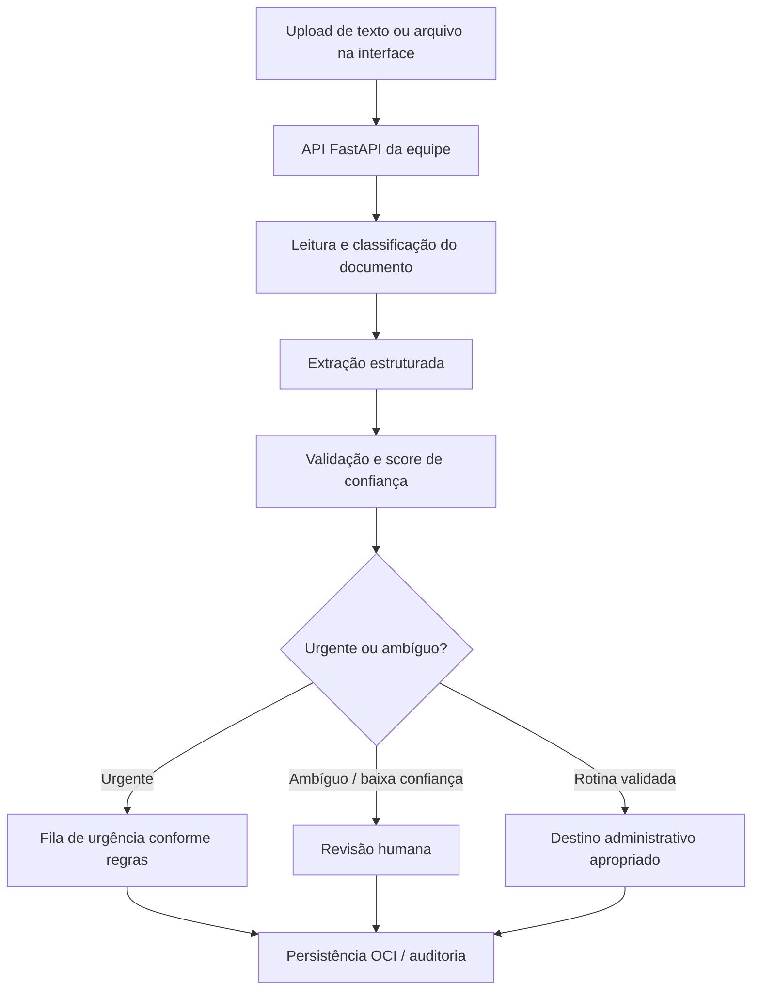

# MediFlow — Parte do Guilherme

Interface inicial de triagem e prompts de classificação/extração para o projeto MediFlow do Hackathon ONE G10.

## Escopo desta pasta

- Prompts de classificação e extração em `prompts/`.
- Interface Streamlit para texto, PDF e imagem em `app.py`.
- Cliente HTTP de exemplo em `api_client.py`.
- Esquema de saída inicial em `schemas.py`.
- Configuração de dependências e proteção de segredos.

## Requisitos do projeto-base

Conforme o PDF do projeto, o MediFlow deve receber documentos clínicos em texto/PDF/imagem, classificar o documento, extrair dados administrativos e clínicos explícitos, avaliar consistência/confiança, sinalizar urgência/ambiguidade e encaminhar casos incertos para revisão humana. O projeto completo também requer integração com OCI Object Storage e demonstração de três cenários: rotina, urgência e ambiguidade/revisão humana.

**Importante:** esta pasta é apenas a parte inicial da interface e dos prompts. Não implementa por si só o fluxo completo de agentes, a API FastAPI, o armazenamento OCI nem alertas de plantão.

## Executar no GitHub Codespaces

Abra a pasta no Codespaces e execute no terminal:

```bash
python -m venv .venv
source .venv/bin/activate
pip install -r requirements.txt
cp .env.example .env
streamlit run app.py
```

No Windows PowerShell, para ativar o ambiente use:

```powershell
.venv\Scripts\Activate.ps1
```

O Streamlit abrirá a interface em uma prévia do Codespaces.

## Conexão com a API

Por padrão, a interface tenta acessar `http://localhost:8000/triagem`. Ajuste no painel lateral ou defina as variáveis `MEDIFLOW_API_URL` e `MEDIFLOW_TRIAGE_PATH`.

O envio de texto usa os campos mostrados no exemplo do PDF:
- `documento_id`
- `tipo_arquivo`
- `documento_texto`
- `canal_origem`

O envio de arquivos usa provisoriamente `multipart/form-data` com o campo `arquivo`. **Esse contrato ainda precisa ser confirmado com o responsável pelo FastAPI** (endpoint, nome do campo e formato esperado). Não considere a integração de arquivo pronta até testar com a API real.

## Gemini

Os prompts estão em `prompts/classificacao.py` e `prompts/extracao.py`. A dependência `google-genai` foi incluída para a integração de modelo numa próxima etapa. O app atual envia o conteúdo à API da equipe e não chama diretamente o Gemini.

Para guardar uma chave em ambiente local:
1. Copie `.env.example` para `.env`.
2. Preencha `GEMINI_API_KEY` no arquivo local.
3. Nunca compartilhe o arquivo `.env` nem faça commit dele.

## Cenários de demonstração

Use somente texto sintético, sem dados reais de pacientes:
1. **Rotina:** atestado fictício legível, sem indicação textual de urgência.
2. **Urgência:** laudo fictício que descreva explicitamente um achado crítico; o fluxo deve encaminhar para a fila urgente segundo as regras da equipe.
3. **Ambiguidade:** documento com campos ausentes ou texto ilegível; deve solicitar revisão humana.

Os exemplos devem ser validados com a equipe clínica/responsável pelo fluxo. Não use o sistema para tomar decisões médicas reais.

## Diagrama de alto nível



## Pendências de integração

- Confirmar endpoint e contrato JSON/multipart com André.
- Alinhar o esquema final com a validação Pydantic da Lethicia.
- Integrar o resultado dos prompts ao pipeline de processamento.
- Implementar e testar conexão real com Gemini em módulo próprio.
- Confirmar com a equipe os critérios de confiança, urgência e roteamento.
- Integrar e validar o armazenamento OCI com o integrante responsável.
