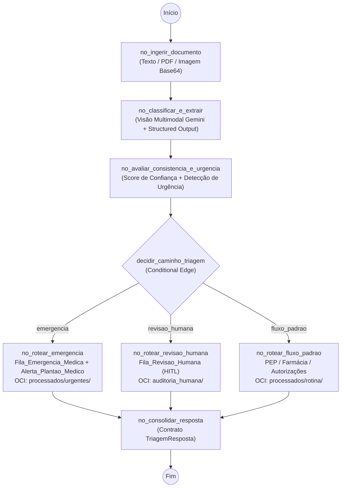

# 📋 Relatório Técnico de Entregas — Ingrid Soares (MediFlow)

> **Projeto:** Projeto 2 – 🏥 MediFlow – Agente Autônomo para Triagem, Extração e Roteamento de Documentos Clínicos  
> **Hackathon:** ONE G10 (Oracle Next Education & Alura)  
> **Repositório:** `No-Country-simulation/g10-Brasil27`  
> **Branch de Trabalho:** `feature/agente-deploy-ingrid`  
> **Responsável:** Ingrid Soares — *Grafo de IA (LangGraph), Visão Multimodal / OCR, Segurança, Redes & Deploy OCI*  
> **Última Atualização:** 26/10/2026

---

## 🎯 1. Escopo de Responsabilidades e Arquitetura Entregue

De acordo com a divisão oficial de tarefas da equipe (`divisao_tarefas_mediflow.pdf`) e o padrão estrutural definido no repositório (`g10-Brasil27`), foram implementadas todas as entregas sob responsabilidade da **Ingrid**:

### 1.1. Grafo de Decisão Condicional (`agente/grafo.py` & `agente/__init__.py`)
Implementação do motor de orquestração autônomo com **LangGraph (`StateGraph`)** utilizando o estado tipado `EstadoAgenteMediFlow` e conectando os contratos Pydantic (`contratos/modelos.py`) às regras clínicas (`regras/regras_clinicas.py`):
- **`no_ingerir_documento`**: Recebe o `DocumentoEntrada` e aciona o pipeline de leitura e normalização documental (`PDF`, `PNG/JPG`, `Base64`, `TXT/JSON`).
- **`no_classificar_e_extrair`**: Executa a análise via **Google Gemini (`gemini-2.5-flash`)** com *Structured Outputs* (`ResultadoExtracaoLLM`) ou fallback clínico determinístico, produzindo `ClassificacaoDocumento` e `DadosExtraidos`.
- **`no_avaliar_consistencia_e_urgencia`**: Calcula o Score de Confiança consolidado (`calcular_score_confianca`), identifica pendências clínicas e detecta quadros críticos de emergência (`detectar_urgencia_clinica`).
- **Aresta Condicional (`decidir_caminho_triagem`)**:
  - **`no_rotear_emergencia`**: Prioridade máxima para achados críticos (ex.: *TEP Agudo*), gerando alerta imediato no canal `Alerta_Plantao_Medico`, roteando para `Fila_Emergencia_Medica` e segregando no bucket OCI em `processados/urgentes/{id}.json`.
  - **`no_rotear_revisao_humana` (*Human-in-the-Loop*)**: Retém documentos com score $< 0.75$, rasuras, carimbo borrado ou ausência de dados essenciais na `Fila_Revisao_Humana`, marcando `status = "pendente_auditoria"` e segregando em `auditoria_humana/{id}.json`.
  - **`no_rotear_fluxo_padrao`**: Encaminha documentos consistentes de rotina para `Farmacia_Hospitalar`, `Auditoria_Autorizacoes` ou `Prontuario_Eletronico_do_Paciente`, segregando em `processados/rotina/{id}.json`.
- **`no_consolidar_resposta`**: Valida e retorna o objeto final `TriagemResposta` através da função de entrada `executar_triagem_mediflow` (e alias `processar_documento` para consumo direto pela API FastAPI do André).

### 1.2. Visão Multimodal / OCR e Leitura de Documentos (`agente/leitor_documentos.py` & `agente/visao_multimodal.py`)
- **Leitura Híbrida de PDFs (`pypdf`)**: Extrai texto nativo de PDFs digitais e detecta automaticamente PDFs escaneados/digitalizados (quando não há camada textual suficiente), encaminhando os bytes `application/pdf` diretamente para a visão multimodal do Gemini.
- **Processamento de Imagens Clínicas (`Pillow`)**: Valida, converte e normaliza fotos de receitas médicas e exames (`PNG`, `JPG`, `WEBP`) recebidas em Base64 (com ou sem cabeçalho *Data URI*).
- **Integração Multimodal `google-genai`**: Envia `types.Part.from_bytes` + instruções clínicas com `response_schema=ResultadoExtracaoLLM` e `temperature=0.1`.
- **Fallback Clínico Determinístico**: Garante funcionamento 100% resiliente em ambientes de teste automatizado (CI/CD) ou sem chave `LLM_API_KEY` configurada.

### 1.3. Apoio Técnico em Prompts (`prompts/extracao_clinica.py`)
- Construção do `SYSTEM_PROMPT_MEDIFLOW`, `PROMPT_OCR_MULTIMODAL`, função `montar_prompt_extracao_texto` e modelo `ResultadoExtracaoLLM` integrados aos contratos da Lethicia e prontos para uso pelo Guilherme e pelo Agente.

### 1.4. Infraestrutura OCI, Redes, Segurança & Deploy (`deploy/` & `.dockerignore`)
- **[`.dockerignore`](../.dockerignore)**: Bloqueia vazamento de `.env`, chaves privadas `*.pem` / `*.key`, `.oci/` e `.venv/` para dentro da imagem.
- **[`deploy/Dockerfile`](../deploy/Dockerfile)**: Build *multi-stage* sobre `python:3.13-slim`, execução com usuário não-root dedicado (`mediflow`, UID `10001`) e `HEALTHCHECK` nativo.
- **[`deploy/docker-compose.yml`](../deploy/docker-compose.yml)**: Orquestração dos serviços `mediflow-api` (porta `8000`) e `mediflow-ui` (porta `8501`) em rede bridge isolada (`mediflow_net`), com `cap_drop: [ALL]`, `no-new-privileges:true`, limites de memória para VMs Always Free e montagem somente leitura (`:ro`) de `~/.oci`.
- **[`deploy/nginx_mediflow.conf`](../deploy/nginx_mediflow.conf)**: Reverse Proxy Nginx com proteção de *rate-limiting* (`10r/s`), suporte a WebSocket para Streamlit e cabeçalhos de segurança HTTP OWASP.
- **[`deploy/setup_oci_vm.sh`](../deploy/setup_oci_vm.sh)** e **[`deploy/README.md`](../deploy/README.md)**: Script automatizado de provisionamento na OCI Compute Always Free (`ufw`, `fail2ban`, hardening `0600` em chaves OCI/env, Docker + Nginx) e documentação de arquitetura cloud.

---

## 🧱 2. Histórico de Commits Atômicos Realizados

Todos os commits seguiram estritamente o padrão *Conventional Commits* em português utilizado no repositório `g10-Brasil27`:

| Ordem | Hash | Mensagem do Commit | Arquivos Criados / Modificados |
| :---: | :--- | :--- | :--- |
| **1** | `a7c0255` | `chore(deps): adiciona langgraph, pypdf e pillow ao requirements.txt` | `requirements.txt` |
| **2** | `b125a02` | `feat(prompts): adiciona prompts estruturados de classificacao e extracao clinica` | `prompts/extracao_clinica.py` |
| **3** | `8196fc5` | `feat(agente): adiciona pipeline de leitura de documentos e visao multimodal` | `agente/leitor_documentos.py`, `agente/visao_multimodal.py` |
| **4** | `b70edb6` | `feat(agente): implementa grafo de decisao condicional com LangGraph` | `agente/grafo.py`, `agente/__init__.py` |
| **5** | `4f10af3` | `test(agente): adiciona testes automatizados do grafo e ingestao multimodal` | `tests/test_agente.py` |
| **6** | `4047ef4` | `feat(deploy): adiciona Dockerfile e docker-compose com hardening de containers` | `.dockerignore`, `deploy/Dockerfile`, `deploy/docker-compose.yml` |
| **7** | `fed7b8a` | `feat(deploy): adiciona scripts de rede, seguranca e provisionamento OCI Always Free` | `deploy/nginx_mediflow.conf`, `deploy/setup_oci_vm.sh`, `deploy/README.md` |
| **8** | *(atual)* | `docs(relatorio): adiciona relatorio tecnico das entregas da Ingrid` | `docs/relatorio_ingrid.md` |

---

## 🧪 3. Validação e Testes Automatizados (`pytest`)

A suíte completa de testes (`tests/test_regras.py` da Lethicia + `tests/test_agente.py` da Ingrid) foi executada com **100% de aprovação (9/9 testes passando)**:

- `test_grafo_cenario_1_rotina_ponta_a_ponta`: **PASSED** (Hemograma ambulatorial $\rightarrow$ `Prontuario_Eletronico_do_Paciente` $\rightarrow$ `processados/rotina/DOC-CLIN-2026-1021.json`).
- `test_grafo_cenario_2_urgencia_tep_agudo_ponta_a_ponta`: **PASSED** (Tomografia com TEP Agudo $\rightarrow$ `Fila_Emergencia_Medica` + Alerta Plantão Médico $\rightarrow$ `processados/urgentes/DOC-CLIN-2026-8942.json`).
- `test_grafo_cenario_3_auditoria_humana_ponta_a_ponta`: **PASSED** (Receituário com rasuras/ilegível $\rightarrow$ Score $0.45$ $\rightarrow$ `Fila_Revisao_Humana` / `pendente_auditoria` $\rightarrow$ `auditoria_humana/DOC-CLIN-2026-3319.json`).
- `test_grafo_roteamento_receituario_farmacia`: **PASSED** (Receituário legível $\rightarrow$ `Farmacia_Hospitalar`).
- `test_ingestao_multimodal_imagem_base64`: **PASSED** (Normalização de imagem Base64 via Pillow e ativação de flag multimodal).
- `test_ingestao_pdf_digitalizado_aciona_visao_multimodal`: **PASSED** (Detecção automática de PDF sem camada de texto para envio ao OCR Multimodal).
- `test_cenario_1_rotina` / `test_cenario_2_urgencia` / `test_cenario_3_auditoria_humana` (`test_regras.py`): **PASSED**.

---

## 🔄 4. Checklist de Status (Atualizável)

- [x] Sincronização do repositório `g10-Brasil27`, revisão e merge do PR #1 (`feature/contratos-lethicia`) na `main`.
- [x] Adição de dependências fixas (`langgraph`, `pypdf`, `pillow`) no `requirements.txt`.
- [x] Implementação dos prompts estruturados e schema LLM (`prompts/extracao_clinica.py`).
- [x] Implementação do pipeline de leitura de documentos e Visão Multimodal (`agente/leitor_documentos.py` e `agente/visao_multimodal.py`).
- [x] Construção do Grafo de Decisão Condicional em LangGraph (`agente/grafo.py` e `agente/__init__.py`).
- [x] Criação e validação da bateria de testes automatizados (`tests/test_agente.py`).
- [x] Criação da infraestrutura Docker, Nginx, Firewall e scripts de deploy na OCI Always Free (`deploy/`).
- [x] Documentação viva atualizada em `docs/relatorio_ingrid.md`.
- [x] Rebase limpo sobre a `main` atualizada e `git push -u origin feature/agente-deploy-ingrid` concluído.
